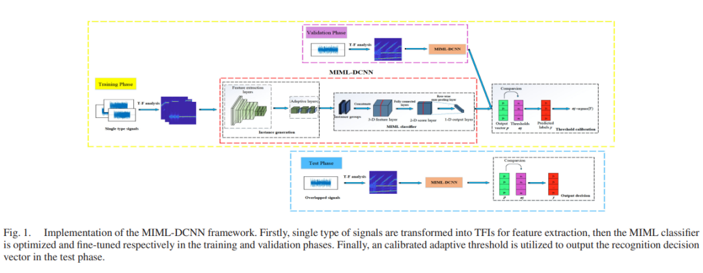
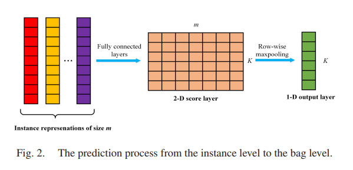
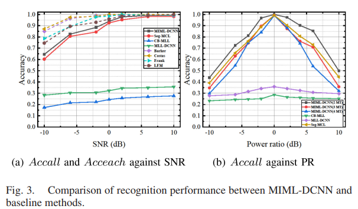
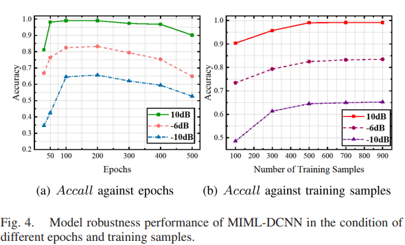

# Radar Signal Selection - Automated Identification of Overlapping Low-Intercept Radar Signals Based on Multi-Example and Multi-Label Learning with Python Code

In the increasingly complex electromagnetic environment, multiple LPI radar transmitters may concurrently transmit signals in similar frequency bands, leading to signal overlap in both time and frequency domains. This paper proposes a multi-instance multi-label learning framework (MIML-DCNN) based on deep convolutional neural networks (DCNNs) for automatically identifying overlapping LPI radar signals, requiring only training with a single type of signal. The framework processes signals in an end-to-end manner, integrating a carefully designed example generation module, a sophisticated MIML classifier, and an adaptive threshold calibration. Comprehensive experiments on simulated overlapping signals of four different modulation types demonstrate that the framework can accurately identify each individual signal type when signals overlap, and is robust to variations in Signal-to-Noise Ratio (SNR) and Power Ratio conditions.
Introduction: With the widespread deployment of LPI radars in modern military equipment, automatic waveform recognition of LPI signals has attracted significant attention in the field of electronic reconnaissance research. Feature-based methods are widely used due to their low computational complexity and robustness to transmission losses, and deep learning methods have also been applied to extract more robust features. However, existing LPI waveform recognition research mainly focuses on the classification of monotonous modulation types.
This paper focuses on the problem of overlapping LPI waveform recognition (OLWR). In complex electromagnetic spectrum environments, multiple LPI transmitters may operate concurrently at similar carrier frequencies, increasing the probability of signal overlap within specific working bands. In this scenario, due to the unknown number of signal sources and limited prior knowledge, traditional manual feature extraction is difficult to distinguish the components of overlapping signals. Multi-class learning (MCL) and multi-label learning (MLL) are potential strategies for handling OLWR, but MCL leads to model scale growth exponentially, while MLL ignores semantic information across different regions. Multi-instance multi-label learning (MIML) can handle problems with multiple semantic labels, but it is currently rarely used for OLWR tasks.
Inspired by this, this paper proposes the MIML-DCNN framework, which differs from existing methods in three aspects: 1) Real signals are usually randomly overlapped, and there is no label correlation in OLWR; 2) OLWR often lacks auxiliary information; 3) Satisfactory performance can be obtained with only one type of signal training. Simulation results show that this framework outperforms MLL and MCL methods, and is robust to different SNR and signal strength levels.
Article illustration
Conclusion This paper introduces the automatic overlapping signal recognition framework MIML-DCNN, which requires only one type of signal training. With the help of an adaptive layer module, it automatically generates informative example representations, decomposes overlapping signals into multiple semantic regions, and performs fine-grained classification at the packet level based on adaptive threshold decisions. Comprehensive experiments prove that this framework achieves high implementation efficiency through single-type signal training and has good robustness under various SNR and power ratio conditions.
End

## Images

<!-- PAYMENT_BLOCK -->

## Get this dataset

- Payment link (Stripe): [Buy now](https://buy.stripe.com/3cs8yP7sY87d0vu9AB)
- Payment QR code: 

<!-- /PAYMENT_BLOCK -->
